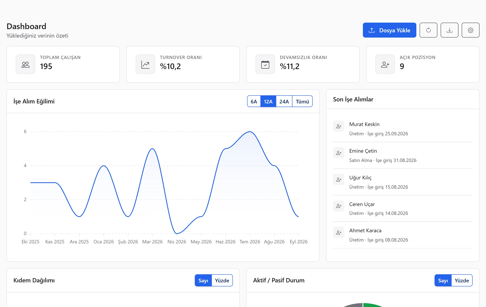
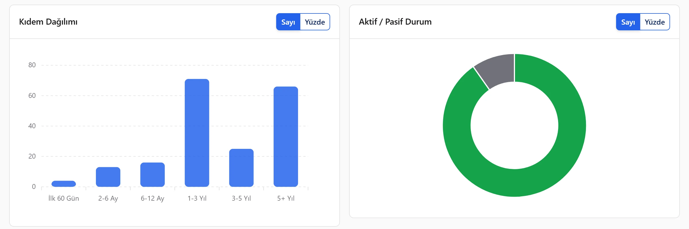
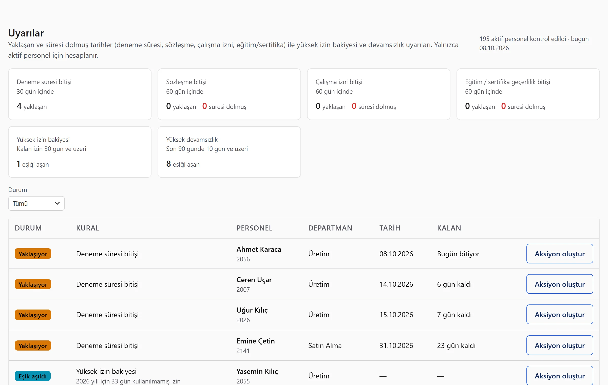
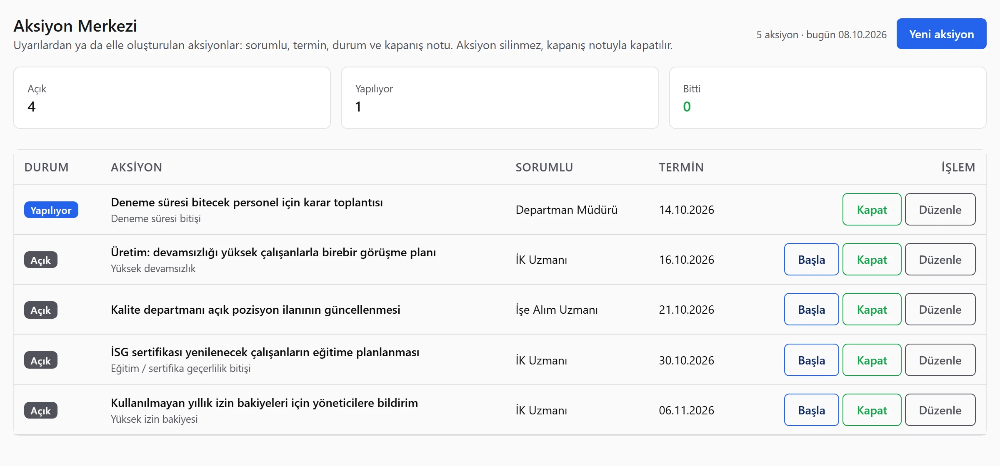
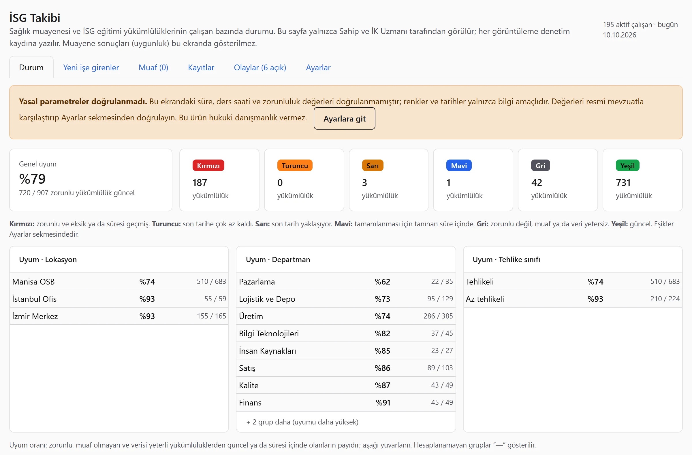
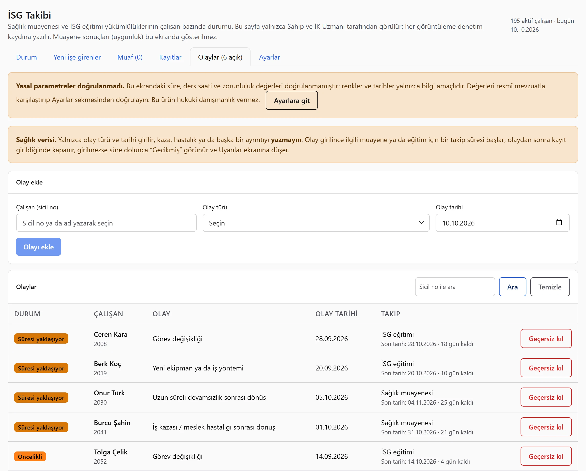
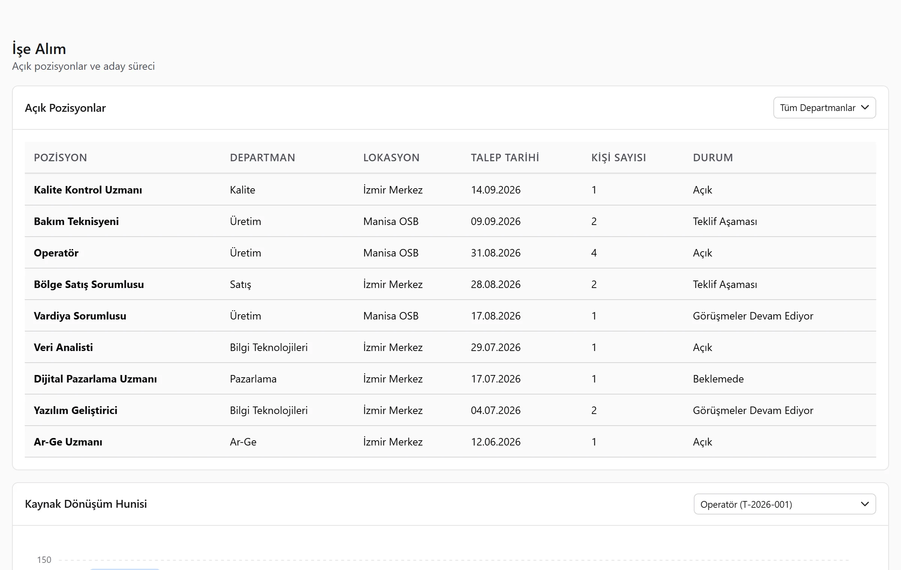
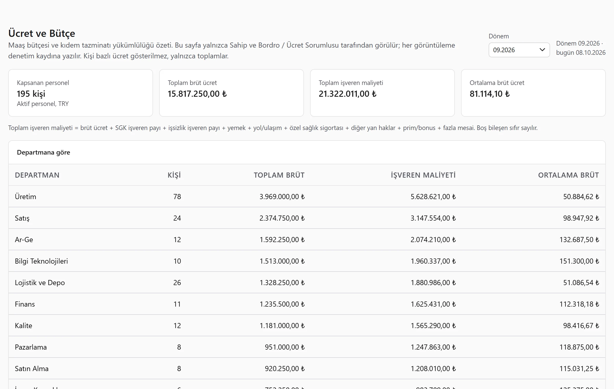

# HR Analitic 360 · Product Demo

HR analytics and decision-support platform for Turkish HR teams. Upload the Excel or CSV files you already keep, and get a live dashboard, early-warning alerts, an action centre, workplace health and safety (İSG) tracking and payroll budget summaries, all computed from your own data. Where data is missing the product says so instead of showing a plausible-looking number.

> **Showcase only.** This repository contains screenshots and a description, **no source code**. The product is proprietary and closed-source. Every screen below shows an **invented sample company** ("Örnek Sanayi A.Ş.", 195 employees); no real person, company or payroll data appears anywhere. The product interface is in Turkish.

**Related:** the product's marketing site is in the companion repository **[hr360-landing-demo](https://github.com/alex-buran/hr360-landing-demo)** ([live page](https://alex-buran.github.io/hr360-landing-demo/)).

## The screens

### Dashboard
Headcount, turnover, absence rate and open positions at a glance, with a hiring trend and drill-down by tenure, department and status.

### Early-warning centre
Rules over the uploaded data (probation ending, unused leave, absenteeism, expiring certificates, overdue İSG obligations) are turned into prioritised alerts.

### Action centre
An alert becomes an owned task with an assignee, a due date and a closing note.

### Occupational health and safety (İSG)
Per-employee status of medical-exam and training obligations by hazard class, with a traffic-light summary, compliance by location and department, an event log that starts follow-up clocks, Excel export and print-to-PDF. The legal parameters are editable and the screen states plainly when they have not been verified. Medical results are never shown on this screen.

### Recruitment
Open positions and a per-requisition funnel from application to hire, to show where candidates are lost.

### Payroll and budget
Department totals only; no per-person pay is shown. Employer cost is built from gross pay plus the statutory and fringe components.

## How it is built

- **Import:** any reasonable Excel, CSV or ODS layout; columns matched by name or alias, validated and reported before anything is saved.
- **Multi-tenant isolation:** every table is protected by row-level security in PostgreSQL, so one company can never read another's rows.
- **Access control:** roles (owner, HR specialist, payroll, training, summary viewer) with a per-endpoint permission matrix and mandatory two-factor sign-in.
- **Audit trail:** every view of personal data is written to an audit log, which stores counts and types, never the data itself.
- **Sensitive fields:** encrypted at rest.
- **Small-group rule:** averages are hidden for groups of fewer than five people.
- **Stack:** Node.js and Express, Supabase (PostgreSQL, Auth), a Bootstrap and Alpine front end.

The release process includes an automated test suite with hand-calculated expectations, deliberate-break (mutation) checks, a staging environment with a real database and a from-scratch security review. An external penetration test is planned before the first customer.

## Status

In active development. Not yet generally available.

## Contact

Built by **[Softburn.tech](https://softburn.tech)**.
